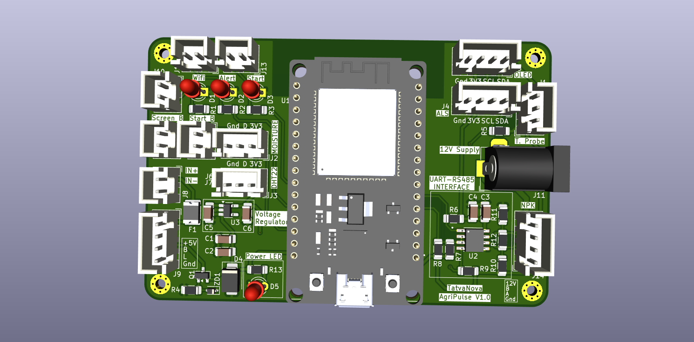
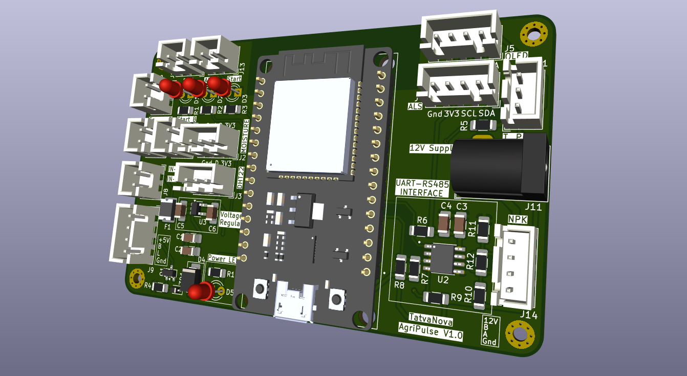

<div align="center">

# AgriPulse PCB

**Custom Embedded Hardware Design using KiCad**

A custom two-layer PCB designed for the AgriPulse Smart Agriculture Monitoring System, integrating ESP32-based control, agricultural sensor interfaces, RS485 communication and power management.


<br><br>



<br><br>


</div>

---

## Project Overview

AgriPulse is a Smart Agriculture Monitoring System developed to integrate multiple agricultural and environmental sensors into a centralized IoT-based monitoring platform.

This repository contains the custom hardware design developed for the AgriPulse system. The PCB is built around the ESP32 DevKit V1 and provides dedicated interfaces for sensor acquisition, communication, power management and peripheral connectivity.

The design incorporates interfaces for soil moisture monitoring, temperature and humidity sensing, external temperature probes and RS485-based NPK sensor communication.

The objective is to provide a modular and centralized hardware platform for agricultural data acquisition and IoT integration.

---

## PCB Design Gallery

<div align="center">

### 3D PCB Visualization



<br>

### PCB Layout


<br>

### Circuit Schematic


</div>

---

## Hardware Specifications

| Parameter | Specification |
|:---|:---|
| Main Controller | ESP32 DevKit V1 |
| RS485 Transceiver | MAX3485ECSA_T |
| Voltage Regulator | TLV75533PDBV |
| Input Supply | 12V DC |
| Regulated Supply | 3.3V |
| Communication | UART / RS485 |
| Sensor Interfaces | Soil Moisture, DHT22, Temperature Probe |
| PCB Architecture | 2-Layer |
| PCB Design Software | KiCad |
| Component Technology | SMD and Through-Hole |

---

## Power Management

The PCB incorporates a dedicated power input and regulation stage.

- 12V DC barrel jack input.
- Polyfuse-based input protection.
- TVS diode-based transient protection.
- PMOS-based power protection.
- TLV75533PDBV 3.3V voltage regulation.
- Input and output decoupling capacitors.
- Dedicated power and ground distribution.

---

## Sensor & Communication Interfaces

### Sensor Interfacing

- Soil moisture sensor interface.
- DHT22 temperature and humidity interface.
- External temperature probe interface.
- Additional GPIO-based peripheral connections.

### RS485 Communication

The board integrates a MAX3485ECSA_T transceiver for differential communication with external agricultural sensors, including the NPK sensor.

- RS485 A/B differential interface.
- UART communication with ESP32.
- Driver and receiver enable control.
- Dedicated external communication connector.

### User Interface

- Start/Stop push-button interface.
- Screen control button.
- Wi-Fi status indication.
- Alert status indication.
- Start/Stop status indication.

---

## Design Highlights

- ESP32 DevKit V1 integration.
- MAX3485-based RS485 communication.
- Dedicated NPK sensor connectivity.
- Multiple agricultural sensor interfaces.
- 12V DC power input.
- Integrated power protection and 3.3V regulation.
- Dedicated peripheral connectors.
- User control and status indication interfaces.
- Two-layer PCB architecture.
- Custom KiCad symbols, footprints and 3D models.
- Copper routing and GND plane design.
- Dedicated PCB mounting holes.

---

## Major Components

| Component | Function |
|:---|:---|
| ESP32 DevKit V1 | Main controller |
| MAX3485ECSA_T | RS485 transceiver |
| TLV75533PDBV | 3.3V voltage regulator |
| PMOS | Power protection |
| Polyfuse | Input current protection |
| TVS Diode | Transient voltage protection |
| Zener Diode | Voltage protection |
| LEDs | Status indication |
| Capacitors | Filtering and decoupling |
| Resistors | Biasing and current limiting |

---

## PCB Design Tools

<div align="center">


</div>

- **KiCad:** Schematic capture and PCB layout.
- **ESP32:** Embedded controller platform.
- **MAX3485:** RS485 differential communication.
- **Custom Libraries:** Component symbols, footprints and 3D models.

---

## Repository Contents

| File / Folder | Description |
|:---|:---|
| `AgriPulse_pcb.kicad_pro` | Main KiCad project file |
| `AgriPulse_pcb.kicad_pcb` | PCB layout document |
| `AgriPulse_pcb.kicad_sch` | Circuit schematic |
| `Libraries/agripulse.pretty/` | Custom PCB footprints |
| `Libraries/DEVKIT_V1_ESP32-WROOM-32/` | ESP32 symbol, footprint and 3D model |
| `Libraries/MAX3485ECSA_T/` | MAX3485 symbol, footprint and 3D model |
| `images/` | PCB renders, layout and schematic images |
| `.gitignore` | Git version control exclusions |

---

## Getting Started

Clone the repository:

```bash
git clone https://github.com/RatnakarSahooVSSUT/AgriPulse_PCB.git
```

Open `AgriPulse_pcb.kicad_pro` using KiCad.

Configure the custom symbol, footprint and 3D model libraries if required.

The repository includes the schematic, PCB layout and custom component libraries used in the design.

---

## Applications

- Smart agriculture monitoring.
- Soil moisture monitoring.
- Environmental parameter acquisition.
- Temperature and humidity monitoring.
- NPK sensor integration.
- RS485-based agricultural sensor communication.
- IoT-based agricultural data acquisition.

---

## Author

<div align="center">

### Ratnakar Sahoo

**Electronics & Telecommunication Engineering**

Veer Surendra Sai University of Technology (VSSUT), Odisha

Interested in Embedded Systems, PCB Design, Hardware Development, FPGA and IoT Technologies.

<a href="https://github.com/RatnakarSahooVSSUT">

</a>

<br><br>

<a href="https://github.com/RatnakarSahooVSSUT/AgriPulse_PCB">

</a>

</div>

---

<div align="center">

**AGRIPULSE | SMART AGRICULTURE | EMBEDDED SYSTEMS**

Designed with KiCad.

</div>
