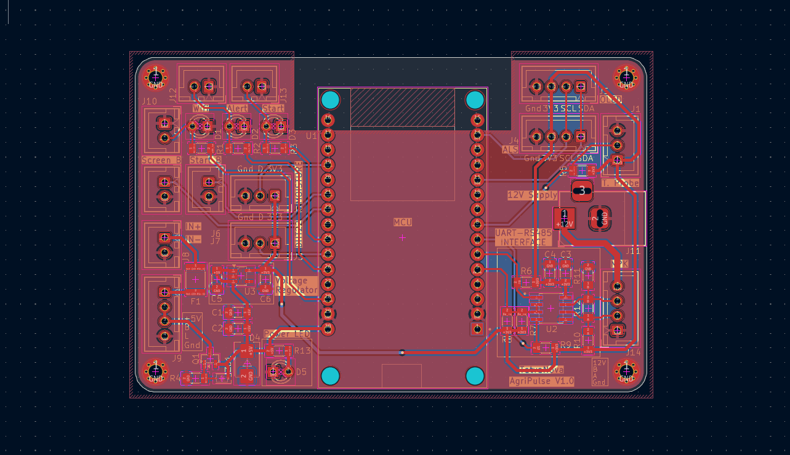
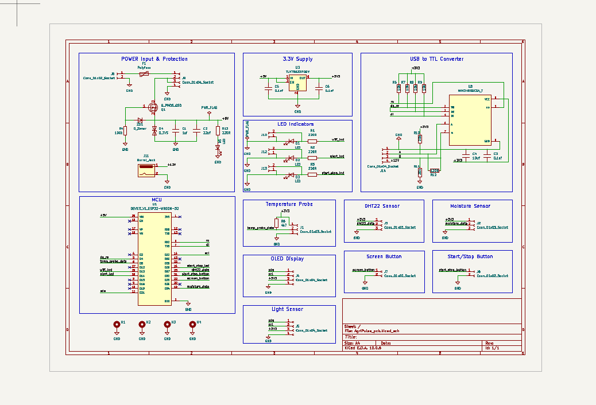

AgriPulse PCB

Custom Embedded Hardware Design using KiCad

A two-layer PCB designed for the AgriPulse Smart Agriculture Monitoring System, integrating an ESP32 development board, multi-sensor interfaces, RS485 communication and power management circuitry.

 

 

Project Overview

AgriPulse is a Smart Agriculture Monitoring System designed to integrate multiple agricultural and environmental sensors into a centralized IoT-based monitoring platform.

This project covers the schematic and PCB design of a custom ESP32-based hardware board developed for sensor acquisition, communication and peripheral control.

The board integrates dedicated interfaces for soil moisture monitoring, temperature and humidity sensing, temperature probe input and RS485-based NPK sensor communication.

The PCB also incorporates a dedicated power management section with 12V DC input, protection circuitry and regulated 3.3V supply generation.

PCB Design Gallery

3D PCB View

Additional 3D View

PCB Layout

Circuit Schematic

Hardware Specifications

Parameter

Description

Main Controller

ESP32 DevKit V1

RS485 Transceiver

MAX3485ECSA_T

Voltage Regulator

TLV75533PDBV

Power Input

12V DC Barrel Jack

Regulated Supply

3.3V

Communication Interface

UART / RS485

Sensor Interfaces

Soil Moisture, DHT22, Temperature Probe

Peripheral Interfaces

GPIO, I2C

PCB Architecture

2-layer

Design Software

KiCad

Component Technology

SMD and Through-Hole

Power Management

The PCB incorporates a dedicated power input and regulation stage designed to provide a stable supply for the ESP32 and connected peripherals.

12V DC barrel jack power input.

Polyfuse-based input protection.

TVS diode-based transient protection.

PMOS-based power protection stage.

TLV75533PDBV 3.3V linear voltage regulator.

Input and output decoupling capacitors.

Dedicated GND and power distribution.

Sensor & Communication Interfaces

Sensor Interfaces

Soil moisture sensor interface.

DHT22 temperature and humidity sensor interface.

External temperature probe interface.

Additional GPIO-based peripheral connections.

RS485 Communication

The board integrates a MAX3485ECSA_T transceiver for differential communication with external agricultural sensors, including the NPK sensor.

RS485 A/B differential interface.

UART communication with ESP32.

Driver and receiver enable control.

Dedicated external communication connector.

User Interface

Start/Stop push-button interface.

Screen control button.

Wi-Fi status indication.

Alert status LED.

Start/Stop status LED.

Design Highlights

ESP32 DevKit V1 integration.

MAX3485-based RS485 communication interface.

Dedicated NPK sensor communication connectivity.

Multiple agricultural sensor interfaces.

12V DC power input and protection circuitry.

3.3V regulated power supply.

Dedicated user control and status indication interfaces.

Two-layer PCB stack-up.

Custom component symbols, footprints and 3D models.

Component placement, copper routing and GND plane design.

Four dedicated PCB mounting holes.

Major Components

Component

Function

ESP32 DevKit V1

Main microcontroller

MAX3485ECSA_T

RS485 transceiver

TLV75533PDBV

3.3V voltage regulator

PMOS

Power protection

Polyfuse

Input current protection

TVS Diode

Transient voltage protection

Zener Diode

Voltage protection

LEDs

Status indication

Capacitors

Filtering and decoupling

Resistors

Biasing and current limiting

Design Tools

KiCad – Schematic capture and PCB layout.

ESP32 – Embedded controller platform.

MAX3485 – RS485 differential communication.

Custom KiCad Libraries – Symbols, footprints and 3D models.

Repository Contents

File / Folder

Description

AgriPulse_pcb.kicad_pro

Main KiCad project

AgriPulse_pcb.kicad_pcb

PCB layout document

AgriPulse_pcb.kicad_sch

Circuit schematic

Libraries/agripulse.pretty/

Custom PCB footprints

Libraries/DEVKIT_V1_ESP32-WROOM-32/

ESP32 symbol, footprint and 3D model

Libraries/MAX3485ECSA_T/

MAX3485 symbol, footprint and 3D model

images/

PCB renders, layout and schematic images

.gitignore

Git ignored files configuration

Applications

Smart agriculture monitoring.

Soil moisture monitoring.

Environmental parameter monitoring.

Temperature and humidity monitoring.

NPK sensor integration.

RS485-based agricultural sensor communication.

IoT-based agricultural data acquisition.

Getting Started

Clone the repository:

git clone https://github.com/RatnakarSahooVSSUT/AgriPulse_PCB.git

Open AgriPulse_pcb.kicad_pro using KiCad to access the complete schematic and PCB design.

The repository includes custom component symbols, footprints and 3D models used in the design.

Author

Ratnakar Sahoo

Electronics and Telecommunication Engineering
Veer Surendra Sai University of Technology (VSSUT), Odisha

Interested in Embedded Systems, PCB Design, Hardware Development, FPGA and IoT Technologies.

GitHub Profile

AgriPulse PCB Repository

AGRIPULSE | SMART AGRICULTURE | EMBEDDED SYSTEMS

Designed with KiCad.

